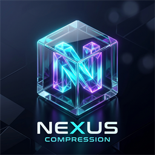

# 🧬 NEXUS Archiver

<p align="center">
  
</p>

<p align="center">
  <b>Neural EXtreme Unified compresSion</b><br/>
  <i>Next-generation, multi-strategy compression engine featuring adaptive pipelines, context mixing, neural bit prediction, and zero-terminal native desktop GUI.</i>
</p>

<p align="center">
  
  
  
  
</p>

---

## 🚀 Key Highlights

- **🧠 Adaptive Chameleon Engine**: Dynamically classifies content (Text, x86 Machine Code, IEEE 754 Floats, Audio PCM, High-Entropy Binary) and routes it to 5 specialized compression paths.
- **⚡ Intuitive Presets & 1–19 Custom Levels**:
  - **Low (Level 2)**: High-speed everyday backups (~120–250 MB/s).
  - **Medium (Level 6)**: Balanced default with dynamic boundary splitting (~30–80 MB/s).
  - **High (Level 9)**: Maximum space savings with deep LZ77 and BWT/MTF/Zero-RLE (~15–30 MB/s).
  - **Custom (Levels 13–16)**: Bit-level Context Mixing with 5 predictive context models and neural logistic mixing.
  - **Custom (Levels 17–19)**: Online integer SGD Neural Network bit prediction.
- **📊 Instant Pre-Flight Size Estimator**: Analyzes sample entropy in `<1 millisecond` to show accurate predicted archive size and space savings *before* you compress.
- **📁 Similarity-Clustered VFS**: Groups related and similar files together before compression, unlocking massive cross-file redundancy that standard ZIP and tar miss.
- **🖥️ Zero-Terminal Native GUI**: Built with `egui` (`#![windows_subsystem = "windows"]`) showing live animated progress, MB/s speed, ETA, and Explorer integration.
- **🔒 100% Deterministic Fixed-Point Math**: Zero floating-point drift ensures bit-exact decompression across Intel, AMD, and ARM processors.

---

## 📥 Installation

### Windows (1-Click)
1. Download **`NEXUS-v0.1.0-Windows-x64.zip`** (or `NEXUS-v0.1.0-Setup.exe`) from the [Latest Release](https://github.com/rushibelkunde/nexus-compressor/releases).
2. Extract and double-click **`install.bat`**.
   - Integrates into File Explorer right-click menus (*Compress with NEXUS...*, *Extract Here*).
   - Associates `.nxar` archives with the custom NEXUS brand logo.
   - Adds *NEXUS Archiver* to the Windows Start Menu.
   - No administrator privileges required!

### Ubuntu / Debian Linux
**Option A: 1-Click .deb Package**
```bash
sudo dpkg -i nexus_0.1.0_amd64.deb
```

**Option B: Tarball Script**
```bash
tar -xzvf NEXUS-v0.1.0-Linux-x64.tar.gz
cd NEXUS-v0.1.0-Linux-x64
./install.sh
```
- Installs `nexus` CLI and `nexus-gui` to `~/.local/bin/`.
- Installs `.desktop` launcher and `.nxar` MIME type associations.
- Adds right-click Nautilus/GNOME context menu scripts.

---

## 🛠️ Usage

### Graphical Interface (GUI)
Simply run `nexus-gui` or right-click any file/folder in your file explorer:
- Right-click any file or folder ➔ **Compress with NEXUS...**
- Right-click any `.nxar` archive ➔ **Extract with NEXUS...** or **Extract Here**

### Command Line Interface (CLI)

```bash
# Compress with presets (low, medium, high)
nexus compress --preset low input_folder/ archive.nxar
nexus compress --preset medium input.txt archive.nxar
nexus compress --preset high dataset.bin archive.nxar

# Compress with custom level (1 to 19)
nexus compress --level 15 database.dump archive.nxar
nexus compress --level 18 deep_text.txt archive.nxar

# Decompress
nexus decompress archive.nxar extracted_output/

# Inspect archive contents without decompression
nexus list archive.nxar
```

---

## 📊 Feature Comparison

| Feature | Classic ZIP | 7-Zip (.7z) | Zstandard (.zst) | NEXUS (.nxar) |
| :--- | :---: | :---: | :---: | :---: |
| **Entropy Coding** | Huffman (1952) | Range Coder | FSE | **rANS + Range Coder** |
| **Sliding Window** | 32 KB | Up to 1 GB | Up to 2 GB | **Dynamic (64 KB – 16 MB)** |
| **Content Transforms** | ❌ None | ⚠️ x86 only | ❌ None | **✅ x86 BCJ, Float Split, Delta, BWT/MTF** |
| **Context Mixing & Neural**| ❌ No | ❌ No | ❌ No | **✅ Yes (Levels 13–19)** |
| **Directory Clustering** | ❌ Alphabetical | ❌ Alphabetical | ❌ Single-file | **✅ Semantic Similarity Sorting** |
| **Pre-Flight Size Preview**| ❌ No | ❌ No | ❌ No | **✅ Instant (<1ms)** |
| **Memory Safe** | ❌ C / C++ | ❌ C / C++ | ❌ C | **✅ 100% Rust** |

---

## 🏗️ Architecture

```
Layer 0: FRAMING       — Two-tier framing (4-16MB Superblocks + 16-512KB Sub-blocks) with Warm LZ77 Dictionary
Layer 1: DETECTION     — Shannon entropy computation & content-type classification
Layer 2: PREPROCESS    — Bijective x86 BCJ branch filter, Float byte-plane splitting, Delta, BWT + MTF + Zero-RLE
Layer 3: COMPRESSION   — Multi-path dispatch (Path A: LZ-ANS, Path B: BWT-ANS, Path C: Context Mixing, Path D: Neural)
Layer 4: CONTAINER     — Modern .nxar container format with footer block tables and XXHash64 validation
```

---

## 🧪 Building from Source

```bash
# Clone the repository
git clone https://github.com/rushibelkunde/nexus-compressor.git
cd nexus-compressor

# Run all 130 unit and integration tests
cargo test

# Build optimized release binaries
cargo build --release --bin nexus --bin nexus-gui
```

---

## 📄 Documentation

- [How NEXUS Beats Other Compressors](docs/how_nexus_beats_other_compression.md)
- [System Architecture](docs/ARCHITECTURE.md)
- [Algorithm Specifications](docs/ALGORITHMS.md)
- [Container Format Specification](docs/FORMAT_SPEC.md)
- [Phase Status & Milestones](docs/PHASE_STATUS.md)

---

## 📜 License

Licensed under either of [Apache License, Version 2.0](LICENSE-APACHE) or [MIT License](LICENSE-MIT) at your option.
